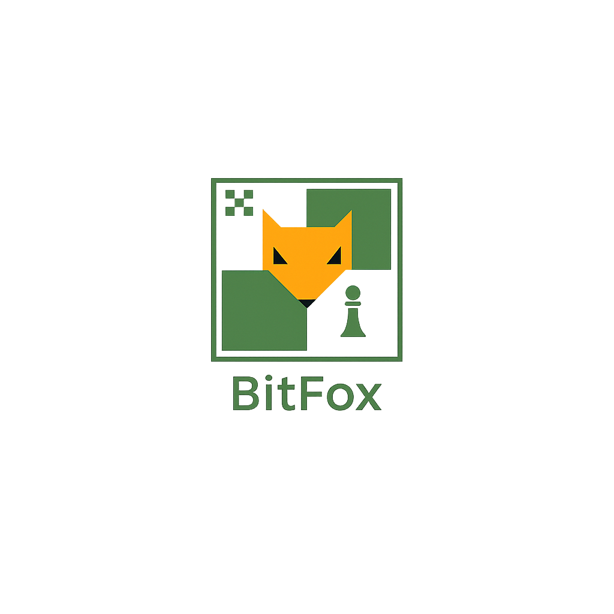
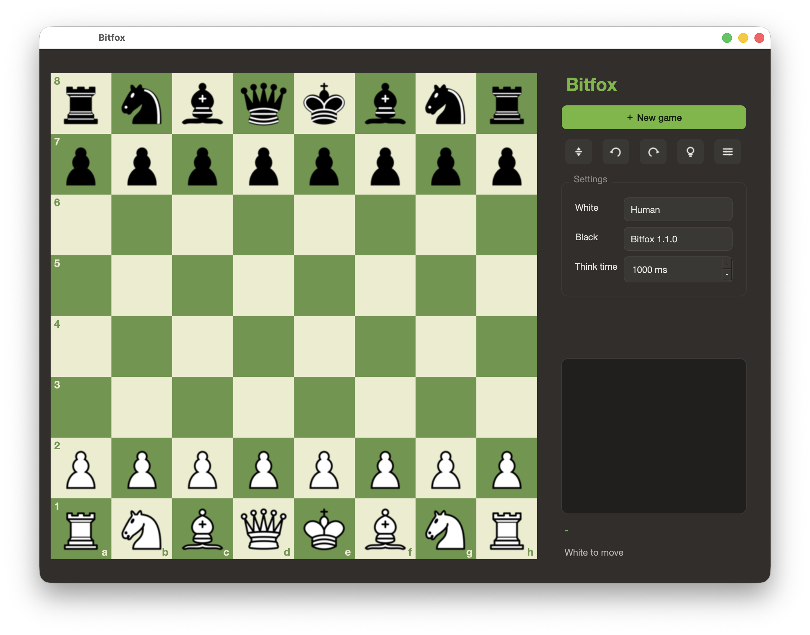

# Bitfox

<p align="center">
  
</p>

[](LICENSE)


<p align="center">
  <a href="https://github.com/Azeel1/bitfox-engine/releases/latest">
    
  </a>
</p>

A UCI chess engine written in Rust. It uses bitboards, alpha-beta search,
and an NNUE evaluation trained from its own self-play data. The same crate also
builds a shared library used by the desktop board.

<p align="center">
  
</p>

## Downloads

Download the latest release from
[GitHub Releases](https://github.com/Azeel1/bitfox-engine/releases/latest).

| System | Desktop board package |
| ------ | --------------------- |
| Windows x86_64 | `bitfox-*-windows-x86_64-gui.zip` |
| macOS arm64 | `bitfox-*-macos-arm64-gui.zip` |
| Linux x86_64 | `bitfox-*-linux-x86_64-gui.tar.gz` |

For UCI-only use, choose the matching engine archive without `-gui` in its
filename. The x86_64 engine archive includes two binaries: `bitfox-avx2` for
CPUs with AVX2 and BMI2, and `bitfox` for older CPUs with SSE4.2 and POPCNT.
Both check the CPU at startup and run the network with AVX-512, AVX2 or SSE2,
so the plain `bitfox` still gets wide vectors for evaluation on a newer CPU.

## Requirements

- Engine: Rust 1.96, pinned in `rust-toolchain.toml`.
- Desktop application: Qt 6, CMake >= 3.21, and native C++ build tools.
- Development commands: Python >= 3.11.

## Development commands

Python 3.11 or newer provides a common entry point from the repository root:

```sh
python3 tools/bitfox.py check
python3 tools/bitfox.py build
python3 tools/bitfox.py test --all-targets --all-features
python3 tools/bitfox.py gui configure
python3 tools/bitfox.py gui build
python3 tools/bitfox.py gui test
```

Use `--dry-run` before a command to inspect its working directory and arguments
without starting a build or engine. `train` forwards its arguments to
`trainer/experiment.py`:

```sh
python3 tools/bitfox.py train --help
```

The engine, Qt application, and training tools live in separate workspaces. The
Qt application uses the engine's C interface for board operations and UCI for
external engines.

## Build

Build the engine:

```sh
cd engine && cargo build --release --locked
```

The optimized UCI binary is written to `engine/target/release/bitfox`. The same
build also produces the shared engine core used by the desktop board.

`make pgo` builds a profile-guided binary at `engine/target/bitfox-pgo` using a
benchmark training run. Measure it against a normal release build on your
hardware; the gain depends on the source, CPU and training workload. Pass
`CPU=x86-64-v3` for an AVX2 build. This target does not replace the engine inside
an existing desktop app.

Build the Qt board:

```sh
python3 tools/bitfox.py gui configure
python3 tools/bitfox.py gui build
python3 tools/bitfox.py gui test
```

On multi-config generators (Visual Studio / Xcode):

```sh
cmake --build build/gui --config Release
```

## Release

Releases are produced by the `Release` workflow in GitHub Actions. The workflow
accepts a commit from `main` only when its tag is exactly `v<engine version>`;
published assets are treated as immutable. The desktop packages bundle Qt, and
FFmpeg where the platform's Qt multimedia backend needs it, so a release also
ships the matching LGPL source:

1. Bump the version in `engine/Cargo.toml`, update `CHANGELOG.md`, and push
   `main`.
2. Run `Release` manually with `publish` off. This builds the review packages.
3. Run `Prepare corresponding source inputs` with the run ID from step 2.
4. Either run `Release` again with `publish` on and `source_inputs_run_id` set
   to the run ID from step 3, or set the repository variable
   `BITFOX_SOURCE_INPUTS_RUN_ID` to that ID and push the `v<version>` tag.

A tag pushed without a source-inputs run fails before anything is published.

The crate version, UCI identity, and release tag must agree; see
[the changelog](CHANGELOG.md) for release notes.

The workflow builds and checks:

- UCI engine archives for Windows x86_64, Linux x86_64, Linux ARM64, and macOS
  arm64.
- Desktop board packages for Windows x86_64, Linux x86_64, and macOS arm64.
- SHA-256 checksum files for every package and a combined `SHA256SUMS` for
  application updates.
- A verified corresponding-source archive and its checksum.

## Engine

The engine includes:

- Bitboard board representation with magic-bitboard sliders, incremental Zobrist
  keys, make/unmake, SEE, and threat-square generation.
- Pseudo-legal move generation with legality resolved on make, perft-verified
  against the standard positions (startpos, Kiwipete, positions 3-6).
- Search with iterative deepening, aspiration windows, principal variation
  search, quiescence, persistent LazySMP helpers, pruning/reduction heuristics,
  and a shared atomic transposition table with four-entry 64-byte clusters.
- NNUE evaluation: a king-bucketed, side-to-move-relative network with a
  768-wide hidden layer, an incremental accumulator, and SIMD kernels for NEON,
  AVX-512, AVX2 and SSE2. A classical PSQT evaluator is kept as a reference.
- Syzygy tablebase probing (3-4-5 piece WDL) for exact endgame scores.

## Strength

Changes that alter the search tree are tested by paired timed self-play matches,
while pure speed changes are measured at fixed depth or node count.

Tagged binaries are published on the
[GitHub Releases page](https://github.com/Azeel1/bitfox-engine/releases). Rated
versions appear on the live
[CCRL complete list](https://computerchess.org.uk/4040/rating_list_all.html).

## Repository layout

```
.
├── engine/                 Rust UCI engine (binary + cdylib)
│   ├── include/             Canonical C ABI header
│   ├── src/
│   │   ├── types/           squares, pieces, moves, bitboards, scores, castling
│   │   ├── board/           state, FEN, make/unmake, Zobrist, SEE, threats
│   │   ├── movegen/         pseudo-legal move generation, magic tables
│   │   ├── search/          iterative deepening, negamax, quiescence,
│   │   │                    ordering, histories, correction history, time
│   │   ├── eval/            NNUE inference, classical PSQT, embedded network
│   │   ├── tools/           perft, bench, datagen subcommands
│   │   ├── tt.rs            shared atomic transposition table
│   │   ├── uci.rs           UCI protocol loop
│   │   ├── ffi.rs           cc_* C ABI consumed by the GUI
│   │   ├── lib.rs           library crate root
│   │   └── main.rs          binary entry point
│   ├── tests/              perft, see, eval, nnue suites
│   └── Cargo.toml
├── gui-qt/                 Qt 6 desktop board and UCI engine launcher
├── trainer/                NNUE training (Bullet) and the text->bulletformat converter
├── tools/                  build, validation, packaging, self-play, and tuning
├── data/openings/          opening positions used by self-play
├── docs/                   architecture, engine, and performance notes
└── Makefile
```

## Architecture

A conventional alpha-beta engine on a bitboard core, evaluated with NNUE.

- **Board.** Pieces are tracked as 64-bit bitboards, one per piece type and two
  per color, with a mailbox, incremental Zobrist keys for the full position,
  pawns, non-pawns by color, minor pieces, and major pieces, plus make/unmake
  with an undo stack. TT lookups mix a halfmove-clock bucket into a separate
  search key. Direct TT score cutoffs are disabled near the fifty-move boundary,
  as is quiescence score refinement. Repetition draws in game state require
  three occurrences;
  search-path cycles may be cut off after the position repeats inside the
  current tree.
- **Sliders.** Bishop, rook, and queen attacks use magic bitboards backed by
  precomputed tables (`movegen/magic.rs`).
- **Move generation.** Moves are produced pseudo-legally in one pass, with
  illegal ones discovered on make, validated by the perft suite.
- **Search.** Negamax PVS with aspiration windows, a shared atomic TT, null-move
  and ProbCut pruning, singular extensions, late move reductions, and a stack of
  history tables. LazySMP workers are created with the `Threads` setting and
  reused across searches; node-limited searches deliberately use only the main
  worker.
- **Evaluation.** A quantised NNUE network, embedded in the binary, evaluated
  incrementally through an accumulator. The engine and trainer import the same
  fixed 768-wide architecture contract. Networks are trained in `trainer/` from
  the engine's own self-play data.

See `docs/ARCHITECTURE.md`, `docs/ENGINE.md`, and `docs/PERFORMANCE.md`
for details.

## Perft and tests

Run the correctness suite (perft, SEE, evaluation, NNUE):

```sh
make test             # optimized test profile in engine/
```

Run perft directly:

```sh
make perft            # perft(6) from the start position
```

The binary exposes `perft` and `divide` subcommands for arbitrary depths and
positions:

```sh
bitfox perft 6
bitfox perft 5 "r3k2r/p1ppqpb1/bn2pnp1/3PN3/1p2P3/2N2Q1p/PPPBBPPP/R3K2R w KQkq - 0 1"
bitfox divide 1
```

## Benchmark

A fixed-depth search over a set of reference positions, reporting total nodes
and nps:

```sh
bitfox bench         # default depth 12
bitfox bench 14
bitfox bench 14 4 16 # depth, threads, Hash MB
```

To compare the speed of two builds, alternate them (A B B A) over several
runs and compare the averages; a single run is too noisy.

## UCI usage

Bitfox speaks the UCI protocol. Start the engine in UCI mode with:

```sh
make run              # bitfox uci
```

Then drive it from any UCI-compatible interface:

```
uci
isready
setoption name Hash value 256
setoption name Threads value 4
position startpos moves e2e4 e7e5
go depth 12
```

| Option        | Type   | Default | Range    | Description                          |
| ------------- | ------ | ------- | -------- | ------------------------------------ |
| `Hash`        | spin   | 64      | 1-4096   | Transposition table size in MB       |
| `Threads`     | spin   | 1       | 1-256    | LazySMP search threads               |
| `SyzygyPath`  | string | empty   |          | Path(s) to Syzygy WDL tables, `;`-separated. A `syzygy/` folder next to the binary loads automatically. |

Search pruning and reduction parameters (`RazorBase`, `LmrBase`, etc.) are also
exposed as UCI spin options for SPSA tuning.

The `bitfox` binary speaks UCI; pair it with Cute Chess, En Croissant, Nibbler,
or any other UCI-compatible interface. The bundled Qt board below is the desktop
interface shown in the screenshot.

## Qt Board

The Qt board in `gui-qt/` is the desktop interface shown above. It builds the
Rust engine core as part of the CMake build; use the commands in [Build](#build).
The default build directory is `build/gui`. The application is `bitfox-board`
on Linux, `bitfox-board.app` on macOS, and `Release/bitfox-board.exe` with
multi-config Windows generators.

It discovers every `Bitfox <version>` binary placed in an `engines/` folder next
to the executable and auto-selects the newest, and its "Get engine versions..."
button lists, downloads, and installs engine releases without leaving the app.
Application updates are checked separately through Settings -> "Check for
application updates...": the board offers the matching desktop package, verifies
its size and SHA-256, then opens it for the user to install. Supported release
packages are Windows x86_64, Linux x86_64, and macOS ARM64.

## Self-play strength gate

`tools/selfplay.py` plays paired, node-limited games between two engine binaries
and reports score, Elo error bars, LOS, and an SPRT verdict. It is a quick
screen for strength-affecting changes:

```sh
python3 -m pip install -r tools/requirements.txt
python3 tools/selfplay.py BASELINE engine/target/release/bitfox --games 400
```

A node-limited search runs on one worker whatever `Threads` is set to, so this
says nothing about time management or LazySMP. Before a release the candidate
also plays a timed match against the previous version with
[Fastchess](https://github.com/Disservin/fastchess); the result is recorded in
the changelog. `tools/spsa.py` tunes the UCI spin options with the same
node-limited games, and tuned values still need a timed match.

## Make targets

```
release     build the optimized engine binary and cdylib
pgo         profile-guided release build (CPU=x86-64-v3 for AVX2)
build       debug build
test        run the perft + correctness suite
check       verify project version, network, ABI, and dependency contracts
tools-test  run the Python tool tests
gui         configure and build the Qt application in build/gui
perft       perft(6) from startpos
divide      perft divide at the root
run         start the engine in UCI mode
windows     cross-compile the Windows engine binary
version     print the current engine version
fmt         cargo fmt
clippy      cargo clippy (deny warnings)
clean       remove engine, Qt, and native build artifacts
```

## Contributing

Keep `cargo fmt` and `cargo clippy --release -- -D warnings` clean.
Move-generation and board changes must keep the perft suite passing; add
positions to `engine/tests/perft.rs` when fixing edge cases. Run `make test`
before opening a pull request, and gate strength-affecting changes with a
self-play match at a real time control.

## Acknowledgements

- [Bullet](https://github.com/jw1912/bullet) for NNUE training.
- The [Chess Programming Wiki](https://www.chessprogramming.org/) for reference.

## License

Bitfox is free software released under the GNU General Public License v3.0 or
later. See [LICENSE](LICENSE).
