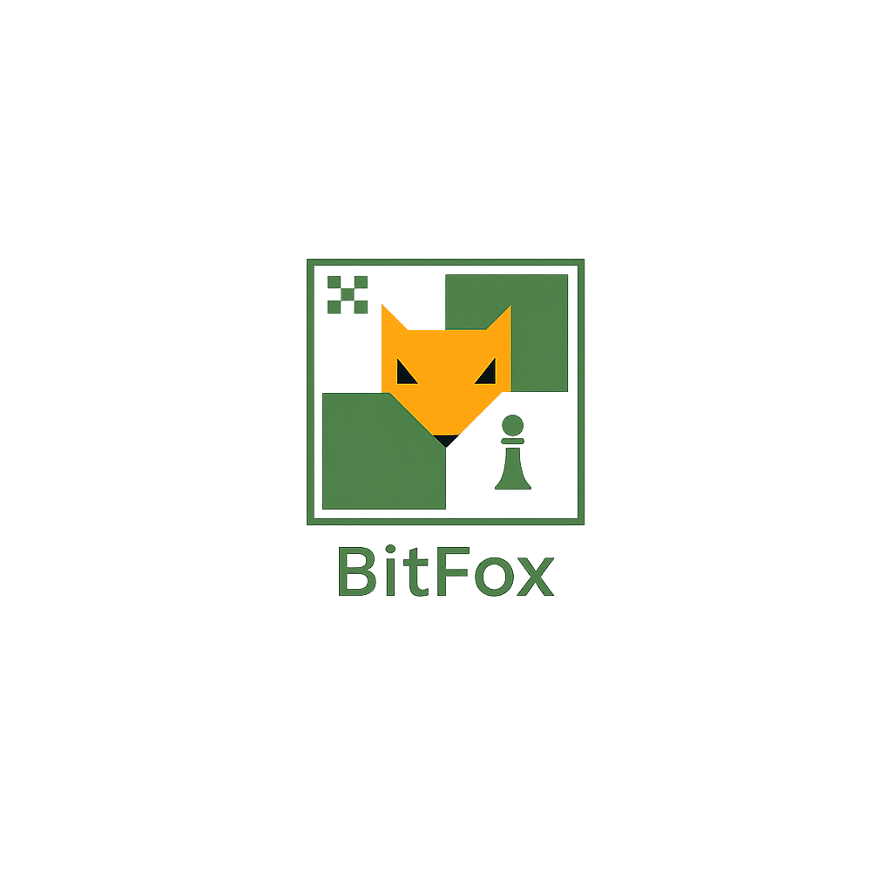
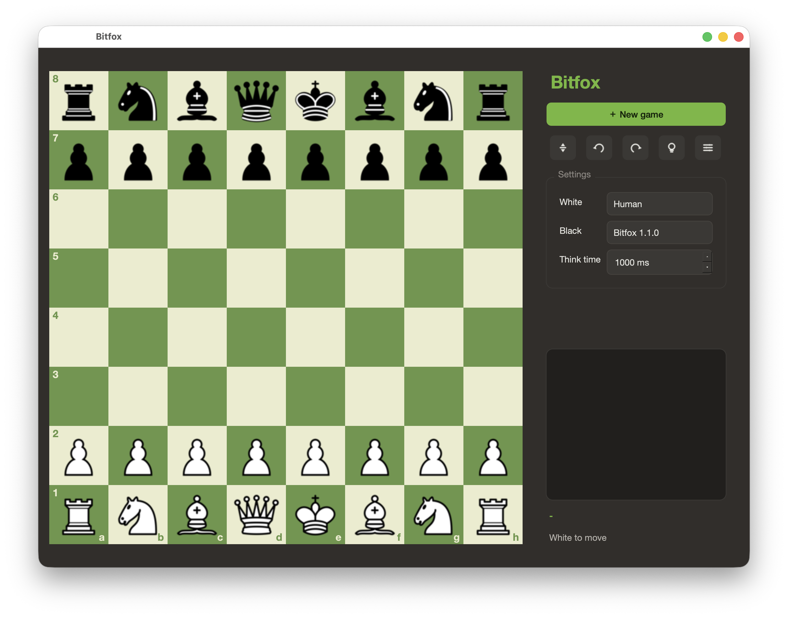

# Bitfox

<p align="center">
  
</p>

[](LICENSE)


<p align="center">
  <a href="https://github.com/Azeel1/bitfox-engine/releases/latest">
    
  </a>
</p>

A UCI chess engine written in Rust. It uses a bitboard board, alpha-beta search,
and an NNUE evaluation trained from its own self-play data. The same crate also
builds a shared library used by the desktop board.

<p align="center">
  
</p>

## Downloads

Download the latest release from
[GitHub Releases](https://github.com/Azeel1/bitfox-engine/releases/latest).

| System | Desktop board package |
| ------ | --------------------- |
| Windows x86_64 | `bitfox-*-windows-x86_64-gui.zip` |
| macOS arm64 | `bitfox-*-macos-arm64-gui.zip` |
| Linux x86_64 | `bitfox-*-linux-x86_64-gui.tar.gz` |

For UCI-only use, choose the matching engine archive without `-gui` in its
filename.

## Requirements

- Rust stable >= 1.85
- Qt 6
- CMake >= 3.21
- Native C++ build tools for your platform

## Build

Build the engine:

```sh
cd engine && cargo build --release
```

The optimized UCI binary is written to `engine/target/release/bitfox`. The same
build also produces the shared engine core used by the desktop board.

Build the Qt board:

```sh
cmake -S gui-qt -B gui-qt/build -DCMAKE_BUILD_TYPE=Release
cmake --build gui-qt/build --parallel
./gui-qt/build/bitfox-board
```

On multi-config generators (Visual Studio / Xcode):

```sh
cmake --build gui-qt/build --config Release
```

## Release

Releases are produced by the `Release` workflow in GitHub Actions. To refresh
the current release packages, run the workflow again with the existing matching
tag, such as `v2.0.0`. For a new release, bump the version in
`engine/Cargo.toml`, update `CHANGELOG.md`, push `main`, then run the workflow
with the new matching tag.

The workflow builds and checks:

- UCI engine archives for Windows x86_64, Linux x86_64, Linux ARM64, and macOS
  arm64.
- Desktop board packages for Windows x86_64, Linux x86_64, and macOS arm64.
- SHA-256 checksum files for every release asset.

## Status

The engine currently has:

- Bitboard board representation with magic-bitboard sliders, incremental Zobrist
  keys, make/unmake, SEE, and threat-square generation.
- Pseudo-legal move generation with legality resolved on make, perft-verified
  against the standard positions (startpos, Kiwipete, positions 3-6).
- Search with iterative deepening, aspiration windows, principal variation
  search, quiescence, a shared atomic transposition table, pruning/reduction
  heuristics, and LazySMP multi-threading.
- NNUE evaluation: a king-bucketed, side-to-move-relative network with an
  incremental accumulator and NEON SIMD on Apple Silicon, with a classical
  PSQT evaluator kept as a reference.
- Syzygy tablebase probing (3-4-5 piece WDL) for exact endgame scores.

Ongoing work is strength tuning: larger networks, more and better training data,
and search-parameter refinement.

## Strength

Strength changes are checked by self-play at a real time control on a local
OpenBench instance, run as an SPRT against the current `main`. Fixed-node
matches are used only as a quick smoke test: several changes that looked
clearly positive at fixed nodes turned out neutral or negative once the clock
was involved, so nothing is kept on a fixed-node result alone.

Bitfox 1.1.0 is independently rated by
[CCRL](https://computerchess.org.uk/ccrl/404/) at 3123 Elo (+11/-11), rank
#199 of 2871 tested engines on the CCRL Blitz list, based on 3520 games
([engine page](https://computerchess.org.uk/404/cgi/engine_details.cgi?print=Details&each_game=1&eng=Bitfox%201.1.0%2064-bit)).

## Repository layout

```
.
├── engine/                 Rust UCI engine (binary + cdylib)
│   ├── src/
│   │   ├── types/          squares, pieces, moves, bitboards, scores, castling
│   │   ├── board/          state, FEN, make/unmake, Zobrist, SEE, threats
│   │   ├── movegen/         pseudo-legal move generation, magic tables
│   │   ├── search/          iterative deepening, negamax, quiescence,
│   │   │                    ordering, histories, correction history, time
│   │   ├── eval/            NNUE inference, classical PSQT, embedded network
│   │   ├── tools/           perft, bench, datagen subcommands
│   │   ├── tt.rs            shared atomic transposition table
│   │   ├── uci.rs           UCI protocol loop
│   │   ├── ffi.rs           cc_* C ABI consumed by the GUI
│   │   ├── lib.rs           library crate root
│   │   └── main.rs          binary entry point
│   ├── tests/              perft, see, eval, nnue suites
│   └── Cargo.toml
├── gui-qt/                 Qt 6 desktop board and UCI engine launcher
├── trainer/                NNUE training (Bullet) and the text->bulletformat converter
├── tools/                  selfplay.py fixed-node smoke test
├── data/openings/          opening positions used by self-play
├── docs/                   architecture, engine, and performance notes
└── Makefile
```

## Architecture

A conventional alpha-beta engine on a bitboard core, evaluated with NNUE.

- **Board.** Pieces are tracked as 64-bit bitboards, one per piece type and two
  per color, with a mailbox, incremental Zobrist keys (full, pawn, and a
  non-pawn key per color), and make/unmake with an undo stack.
- **Sliders.** Bishop, rook, and queen attacks use magic bitboards backed by
  precomputed tables (`movegen/magic.rs`).
- **Move generation.** Moves are produced pseudo-legally in one pass, with
  illegal ones discovered on make, validated by the perft suite.
- **Search.** Negamax PVS with aspiration windows, a shared atomic TT, null-move
  and ProbCut pruning, singular extensions, late move reductions, and a stack of
  history tables, parallelized with LazySMP.
- **Evaluation.** A quantised NNUE network, embedded in the binary, evaluated
  incrementally through an accumulator. Networks are trained in `trainer/` from
  the engine's own self-play data.

See `docs/ARCHITECTURE.md`, `docs/ENGINE.md`, and `docs/PERFORMANCE.md`
for details.

## Perft and tests

Run the correctness suite (perft, SEE, evaluation, NNUE):

```sh
make test             # cargo test --release in engine/
```

Run perft directly:

```sh
make perft            # perft(6) from the start position
```

The binary exposes `perft` and `divide` subcommands for arbitrary depths and
positions:

```sh
bitfox perft 6
bitfox perft 5 "r3k2r/p1ppqpb1/bn2pnp1/3PN3/1p2P3/2N2Q1p/PPPBBPPP/R3K2R w KQkq - 0 1"
bitfox divide 1
```

## Benchmark

A fixed-depth search over a set of reference positions, reporting total nodes
and nps:

```sh
bitfox bench         # default depth 12
bitfox bench 14
```

## UCI usage

Bitfox speaks the UCI protocol. Start the engine in UCI mode with:

```sh
make run              # bitfox uci
```

Then drive it from any UCI-compatible interface:

```
uci
isready
setoption name Hash value 256
setoption name Threads value 4
position startpos moves e2e4 e7e5
go depth 12
```

| Option        | Type   | Default | Range    | Description                          |
| ------------- | ------ | ------- | -------- | ------------------------------------ |
| `Hash`        | spin   | 64      | 1-4096   | Transposition table size in MB       |
| `Threads`     | spin   | 1       | 1-256    | LazySMP search threads               |
| `SyzygyPath`  | string | empty   |          | Path(s) to Syzygy WDL tables, `;`-separated. A `syzygy/` folder next to the binary loads automatically. |

The `bitfox` binary speaks UCI; pair it with Cute Chess, En Croissant, Nibbler,
or any other UCI-compatible interface. The bundled Qt board below is the desktop
interface shown in the screenshot.

## Qt Board

The Qt board in `gui-qt/` is the desktop interface shown above. It builds the
Rust engine core as part of the CMake build:

```sh
cmake -S gui-qt -B gui-qt/build -DCMAKE_BUILD_TYPE=Release
cmake --build gui-qt/build --parallel
./gui-qt/build/bitfox-board
```

It discovers every `Bitfox <version>` binary placed in an `engines/` folder next
to the executable and auto-selects the newest, and it has an in-app version
manager (Settings -> "Get more versions...") that lists, downloads, and
installs GitHub releases without leaving the app.

## Self-play strength gate

Strength-affecting changes are gated by an SPRT at a real time control on a
local OpenBench instance, which builds both branches from source and plays them
against each other.

`tools/selfplay.py` plays paired, node-limited games between two engine binaries
and reports score, Elo error bars, LOS, and an SPRT verdict. It is useful as a
quick check that a change is not broken, but a fixed-node result is not enough
on its own to keep a change:

```sh
python3 tools/selfplay.py BASELINE engine/target/release/bitfox --games 400
```

## Make targets

```
release   build the optimized engine binary and cdylib
build     debug build
test      run the perft + correctness suite
perft     perft(6) from startpos
divide    perft divide at the root
run       start the engine in UCI mode
windows   cross-compile the Windows engine binary
version   print the current engine version
fmt       cargo fmt
clippy    cargo clippy (deny warnings)
clean     remove engine, Qt, and native build artifacts
```

## Contributing

Keep `cargo fmt` and `cargo clippy --release -- -D warnings` clean.
Move-generation and board changes must keep the perft suite passing; add
positions to `engine/tests/perft.rs` when fixing edge cases. Run `make test`
before opening a pull request, and gate strength-affecting changes with a
self-play match at a real time control.

## Acknowledgements

- [Bullet](https://github.com/jw1912/bullet) for NNUE training.
- The [Chess Programming Wiki](https://www.chessprogramming.org/) for reference.

## License

Bitfox is free software released under the GNU General Public License v3.0 or
later. See [LICENSE](LICENSE).
